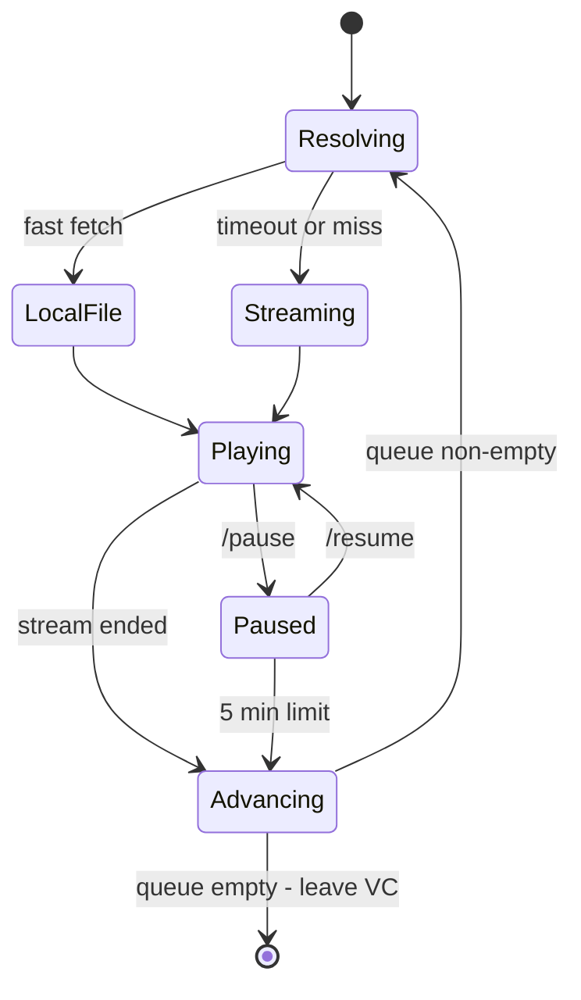
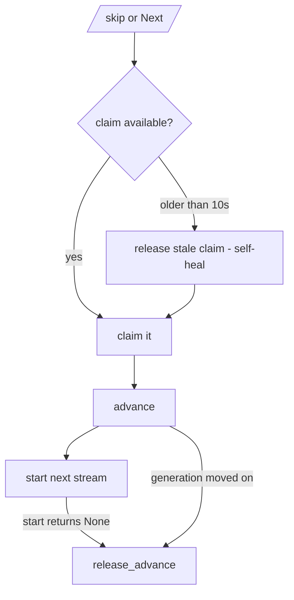
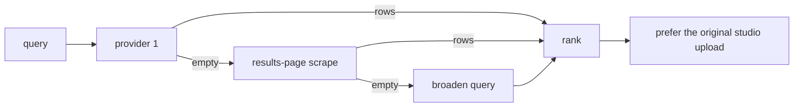

# Architecture

Mikasa streams audio into Telegram voice chats with **PyTgCalls**. The design
goal is single: *the music must not stutter, and a failure must never stop the
queue.*

## Playback pipeline


Every tier falls through to the next, so one dead source costs a song nothing.

## Why local-first

A network stream can starve the ffmpeg pipe mid-song. That was measured, not
assumed:

```
source underruns 0, consumer stalls 0, pipe fill avg 50 KB min 0 B
```

`min 0 B` is a starved pipe - the cause of the reported stutter. Playing from
disk removes the dependency. A bounded download timeout (`VC_LOCAL_FIRST_TIMEOUT`,
default 12 s) falls back to streaming when the fetch is slow.



## The skip guard

`/skip` takes a per-chat **advance claim** so two skips cannot double-jump -
but a claim that was taken and never released silently blocked *every* later
skip. That was a real bug. The fix is two-fold:



Both early-exit paths now hand the claim back, and a claim older than 10 s is
treated as dead, so the feature recovers on its own.

## Control panel

```
row 1   MM:SS | filled knob empty | -MM:SS     progress, always present
row 2   -15s                            +15s
row 3   Replay          Pause/Resume        Next
row 4   Autoplay
```

- The panel is registered when posted and re-coloured on a **synced clock**
  (monotonic schedule that compensates for its own work time, so the colours
  and the progress bar never drift apart).
- Colours are randomised but **touching buttons never match** - a geometric
  adjacency check, not a column index. A 1-2-3-1 grid cannot be perfectly
  coloured with three colours, so the minimum is found exactly and one of the
  best colourings is picked at random each tick.
- A cosmetic `FloodWait` on the panel must **never** skip the track. This was a
  real bug: Telegram's edit flood was caught by the playback error handler and
  treated as a failed track.

## Search



Ranking deliberately prefers `- Topic` / `official audio` uploads and
penalises lofi rips, fan edits and promo pre-rolls. Some bare titles return
**zero** videos from YouTube itself (a word in the title reads as profanity),
which is why an empty sweep is retried with a short suffix before reporting
"not found".

## Background guards

| Module | Job |
|---|---|
| `idle_guard` | bounds a pause to 5 min; leaves the VC after 30 min idle |
| `assistant_guard` | re-adds the assistant to any group it is missing from |
| `disco` | panel colours + progress bar, one synced clock |
| `housekeeping` | storage hygiene, stale file cleanup |

## Failure philosophy

- A failing source falls through; it never ends the queue.
- A cosmetic failure (panel edit, reaction) is never escalated into playback
  control.
- Any API endpoint that fails is parked by a breaker rather than retried on
  every tier, so a dead provider costs seconds, not silence.
