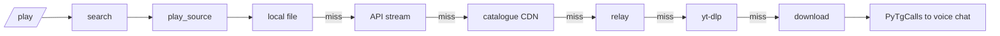

<div align="center">
  
</div>

<div align="center">

[](https://github.com/Igoanet/mikasa-music-bot/stargazers)
[](https://github.com/Igoanet/mikasa-music-bot/network)
[](https://github.com/Igoanet/mikasa-music-bot/watchers)
[](https://github.com/Igoanet/mikasa-music-bot)

[](https://python.org)
[](https://core.telegram.org/bots/api)
[](https://github.com/pytgcalls/pytgcalls)
[](LICENSE)
[](https://github.com/Igoanet/mikasa-music-bot/commits/main)
[](https://github.com/Igoanet/mikasa-music-bot)

<br>

**🎵 Smooth, jitter‑free music for Telegram voice chats.**

*Local‑first playback · live control panel · a skip that always works*

<br>
</div>

---

<div align="center">

### 📱 What you see when you hit /start


<sub>Now‑playing panel: a live progress bar, four clean rows, colours that rotate without ever clashing</sub>

</div>

---

## ✨ Why this bot

Most music bots stutter, skip songs by themselves, and drift out of sync. **Mikasa was built to fix exactly that.**

| | |
|---|---|
| 🎧 **Local‑first playback** | The track is fetched through the API and played **from disk**, so a network blip can never starve the voice chat. |
| 🎛️ **Live control panel** | Progress bar, seek ±15s, replay, pause/resume, next and autoplay across four clean rows. |
| 🌈 **Disco buttons** | Panel colours reshuffle every 2s — randomised so **no two touching buttons ever match**. |
| ⏭️ **A skip that works** | A stale‑claim guard means `/skip` always advances, even after a failed play. |
| 🎚️ **Smarter search** | Prefers the original studio upload — no lofi rips, no fan edits, no promo pre‑rolls. |
| 🌏 **Search that recovers** | If a title returns nothing, the query is broadened instead of reporting *"not found"*. |
| 😴 **Auto‑leave** | A pause is honoured for 5 minutes; the bot leaves after 30 minutes idle. |
| 🤖 **Assistant guard** | Keeps the assistant a member of every group it should serve — and repairs a kick by itself. |

---

## 🎵 Commands

| Command | What it does |
|---|---|
| `/play <song or link>` | Search and play — or queue if something is already going |
| `/pause` · `/resume` | One toggle: **Pause** while playing, **Play** while paused |
| `/skip` | Advance to the next track in the queue |
| `/seek <sec>` · `/seekback [sec]` | Jump forward, or back 15s by default |
| `/queue` | Now playing + everything lined up (text only, no buttons) |
| `/autoplay on\|off` | Let the bot keep the music going when the queue runs dry |
| `/stop` | Stop and leave the voice chat |

---

## 🏗️ How playback chooses a source



Every tier falls through to the next, so one dead source costs a song nothing.

**[→ Read the full architecture](ARCHITECTURE.md)** — the state machine, the skip guard, the synced colour clock and the measured `pipe fill` telemetry that drove the local‑first design.

---

## 🚀 Quick start

```bash
git clone https://github.com/Igoanet/mikasa-music-bot
cd mikasa-music-bot

python3 -m venv .venv && source .venv/bin/activate
pip install -r requirements.txt

cp .env.example .env      # then fill it in
python3 -m bobby
```

**Requires `ffmpeg`** on the host.

---

## ⚙️ Configuration

| Variable | Purpose |
|---|---|
| `API_ID` · `API_HASH` | Telegram app credentials |
| `BOT_TOKEN` | Token from [@BotFather](https://t.me/BotFather) |
| `OWNER_ID` | Your numeric Telegram id |
| `SESSION` | Assistant account string session |
| `YUKI_API_KEY` | Music API key for the instant‑stream tier |
| `VC_LOCAL_FIRST` | `true` plays from disk first — recommended |
| `VC_PAUSE_LIMIT` | Seconds a pause stays valid (default `300`) |
| `DISCO_EVERY` | Panel colour interval in seconds (default `2`) |

---

## 📊 Diagnostics

The bot reports its own health, so problems are visible instead of guessed:

```
pulse[-100…] rqc7f6rBTAg: source underruns 0, consumer stalls 0,
   pipe fill avg 58 KB min 40992 B, send gaps 0, socket rx drops 0
```

That line is what proved the stutter was a **starved pipe** (`min 0 B`) and drove the local‑first fix — rather than assuming.

---

## 🤝 Contributing

See **[CONTRIBUTING.md](CONTRIBUTING.md)** — every audio source is a *tier* that returns `None` on failure, and every background job is registered in `__main__.py`.

---

## 🔐 Security

`.env`, `*.session`, `cookies.txt`, `downloads/` and all media are excluded by `.gitignore`.
**A `.session` file grants full account access.**

See **[SECURITY.md](SECURITY.md)**.

---

## 📜 License

MIT — see [LICENSE](LICENSE).

<div align="center">
<br>

**If this bot sounds good in your group, a ⭐ helps others find it.**

<a href="https://github.com/Igoanet/mikasa-music-bot/stargazers">
  
</a>

<br><br>


</div>
