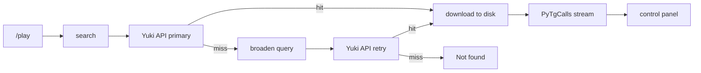

<div align="center">
  
</div>

<div align="center">

[](https://github.com/Igoanet/mikasa-music-bot/stargazers)
[](https://github.com/Igoanet/mikasa-music-bot/network)
[](https://github.com/Igoanet/mikasa-music-bot/watchers)
[](https://github.com/Igoanet/mikasa-music-bot)

[](https://python.org)
[](https://core.telegram.org/bots/api)
[](https://github.com/pytgcalls/pytgcalls)
[](LICENSE)
[](https://github.com/Igoanet/mikasa-music-bot/releases)
[](https://github.com/Igoanet/mikasa-music-bot/commits/main)

<br>

**🎵 Smooth, jitter-free music for Telegram voice chats.**

*Local-first playback · live disco control panel · a skip that always works · full owner command centre*

<br>
</div>

---

<div align="center">

### 📱 What you see when you hit /start


<sub>Now-playing panel: a live progress bar, four clean rows, premium animated emoji, colours that rotate without ever clashing</sub>

</div>

---

## ✨ Why this bot

Most music bots stutter, skip songs by themselves, and drift out of sync. **Mikasa was built to fix exactly that.**

| Feature | Detail |
|---|---|
| 🎧 **Local-first playback** | Track is fetched and played **from disk**, so a network blip never starves the voice chat |
| 🎛️ **Live disco control panel** | Progress bar, seek ±15 s, replay, pause/resume, next, loop and autoplay across four clean rows |
| 🌈 **Disco buttons** | Panel colours reshuffle every 5 s — randomised so **no two touching buttons ever match** |
| ⭐️ **A skip that works** | A stale-claim guard means `/skip` always advances, even after a failed play |
| 🎚️ **Smarter search** | Prefers the original studio upload — no lofi rips, no fan edits, no promo pre-rolls |
| 🌐 **Search that recovers** | If a title returns nothing, the query is broadened instead of reporting *"not found"* |
| 😴 **Auto-leave** | Pause honoured for 5 min; bot leaves after 30 min idle |
| 🤖 **Assistant guard** | Keeps the assistant a member of every group it should serve — repairs a kick by itself |
| 👑 **Full Owner Panel** | One `/owner` command opens a private control hub: assistants, stats, group console, sudoers, blacklist, streams, storage, broadcast, restart and more |
| 📢 **Smart broadcast** | Broadcast with optional silent **pin** in every group where the bot has pin permission |
| 🗺️ **Multi-language** | 13 built-in locales — ar, de, en, es, fr, hi, ja, my, pa, pt, ru, tr, zh |

---

## 🎵 Playback Commands

| Command | What it does |
|---|---|
| `/play <song or link>` | Search and play — or queue if something is already running |
| `/vplay <song or link>` | Same as `/play`, streams as video |
| `/song <query>` | Download and send the song as an audio file |
| `/pause` · `/resume` | Toggle pause/resume |
| `/skip` | Advance to the next track |
| `/seek <sec>` | Jump forward by seconds |
| `/seekback [sec]` | Jump back (default 15 s) |
| `/queue` | Now-playing + everything lined up |
| `/loop` | Loop the current track |
| `/shuffle` | Shuffle the queue |
| `/speed <0.5–2.0>` | Change playback speed |
| `/autoplay on\|off` | Keep music going when queue runs dry |
| `/stop` | Stop and leave the voice chat |
| `/active` | List all chats with active streams |

---

## 👑 Owner Panel

One tap to `/owner` in your DM — every section answers in-place.

| Section | What it does |
|---|---|
| 👥 **Assistants** | View and manage all userbot assistant sessions |
| 📊 **Stats** | Users, groups, assistants, sudoers, blacklist counts — live |
| 🛡 **Admin Groups** | Full scan: every group where the bot is admin, with per-group permission breakdown |
| 👑 **Sudoers** | List and manage sudo-level users |
| 🛠 **Group Console** | Browse all admin groups (paginated), tap any group → Rights / Invite Link / Banned List / Mass-ban / Add Bot / Remove |
| 📄 **Log channel** | Show and test the bound log channel |
| 🚫 **Blacklist** | Blocked groups and users counts |
| 📡 **Streams** | Live view of all active voice chat streams |
| 🧹 **Storage** | Downloads, cache and disk usage + one-tap clean |
| 🔒 **Play mode** | Per-group `/playmode admins\|everyone` reference |
| 📢 **Broadcast** | Reply to any message → choose 📌 With Pin or 📢 No Pin |
| 📜 **Commands** | Full command reference in DM |
| 🔄 **Restart** | Confirm and restart (systemd brings it straight back) |
| ✖ **Close** | Delete the panel |

### Owner-only silent commands

| Command | What it does |
|---|---|
| `/massban <chat_id>` | Ban every non-admin member silently — nothing posted to the group |
| `/manage <chat_id>` | Invite link + banned list panel for any group |
| `/chatlink <chat_id>` | Export or generate an invite link (bot → assistant fallback) |
| `/bans <chat_id>` | List banned users |
| `/unban <chat_id> <user_id>` | Lift a ban |
| `/groups` | List all known groups with member counts |
| `/ginfo <chat_id>` | Full group info + bot privilege breakdown |
| `/gsay <chat_id> <text>` | Send a message to any group from DM |
| `/broadcast` | Reply to a message to broadcast it (with or without pin) |
| `/addsudo` · `/delsudo` | Manage sudo users |
| `/blacklist` · `/unblacklist` | Block / unblock a chat or user |
| `/setlog` · `/unsetlog` | Bind or unbind the log channel |

---

## 🏗️ How playback chooses a source



---

## ⚙️ Self-host Setup

### Requirements

- Python **3.11+**
- `ffmpeg` in PATH
- Telegram **API ID** and **API Hash** — [my.telegram.org](https://my.telegram.org)
- A bot token from [@BotFather](https://t.me/BotFather)
- A userbot assistant session string (Pyrogram)

### Quick start

```bash
git clone https://github.com/Igoanet/mikasa-music-bot.git
cd mikasa-music-bot
pip install -r requirements.txt
cp config.env.example config.env   # fill in your values
python -m bobby
```

### Environment variables

| Variable | Required | Description |
|---|---|---|
| `BOT_TOKEN` | ✅ | Your bot token from BotFather |
| `API_ID` | ✅ | Telegram API ID |
| `API_HASH` | ✅ | Telegram API Hash |
| `OWNER_ID` | ✅ | Your Telegram numeric user ID |
| `SESSION_STRING` | ✅ | Pyrogram session string for the assistant |
| `LOGGER_ID` | ☑️ | Channel or group ID for log events |
| `SUDO_USERS` | ☑️ | Space-separated user IDs with sudo rights |
| `DATABASE_URL` | ☑️ | Postgres URL (uses local JSON if unset) |

---

## 🗂️ Project Layout

```
mikasa-music-bot/
├── bobby/
│   ├── core/           # bot client, database, calls engine, VC monitor
│   ├── helpers/        # inline buttons, poster generator, emoji IDs, lang loader
│   ├── locales/        # 13 locale JSON files
│   └── plugins/        # one file per feature
│       ├── play.py     # /play /vplay /song
│       ├── controls/   # pause resume skip seek loop shuffle speed stop
│       ├── owner.py    # /owner panel + Admin Groups scan
│       ├── ownerextra.py     # Group Console full UI
│       ├── owner_console.py  # /massban /manage /chatlink /bans /unban /groups
│       ├── broadcast.py      # /broadcast with pin/no-pin
│       ├── sudoers.py        # /addsudo /delsudo
│       ├── blacklist.py      # /blacklist /unblacklist
│       └── ...
├── assets/
│   ├── banner.svg
│   └── start-preview.jpg
├── requirements.txt
└── README.md
```

---

## 🛡️ Security

See [SECURITY.md](SECURITY.md) for the responsible-disclosure policy.

---

## 📝 License

MIT © [Igoanet](https://github.com/Igoanet) — see [LICENSE](LICENSE).

---

<div align="center">

Made with ⚔️ by **Igoanet**

*Bot: [@MikasaMusic_Bot](https://t.me/MikasaMusic_Bot)*

</div>
